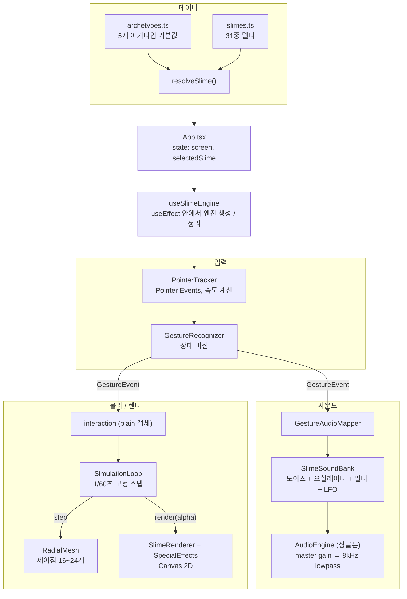

# 슬라임 라빈스 (Slime Robins) 🍦

아이스크림 가게처럼 31가지 슬라임 "맛"을 고르고, 고른 슬라임을 손가락으로 늘리고 누르고 두드리며 ASMR 소리를 듣는 인터랙티브 웹 장난감입니다.

[🔗 소개 페이지 열기](https://html-preview.github.io/?url=https://github.com/jsj1215/slime-robins/blob/main/docs/intro.html) · [docs/intro.html](docs/intro.html)

> GitHub Pages를 켜면 `https://jsj1215.github.io/slime-robins/docs/intro.html` 에서도 소개 페이지를 볼 수 있습니다.

## 왜 만들었나

"31가지 맛을 고르는 아이스크림 가게"라는 익숙한 틀은 겉모습이고, 안쪽의 목표는 기술 실험입니다. 녹음 파일이나 물리 엔진 라이브러리 없이 브라우저 표준 API만으로, 손에 붙는 감촉과 소리를 얼마나 그럴듯하게 낼 수 있는지 확인해보고 싶었습니다.

우선순위는 처음부터 정해두었습니다.

1. **소리가 먼저.** ASMR 슬라임 영상의 재미는 대부분 소리에서 나옵니다. 제스처가 들어오면 사운드가 바로 반응하고, 속도와 압력에 따라 실시간으로 변해야 합니다.
2. **물리는 그다음.** 슬라임이 퍼지고, 뭉치고, 길게 늘어나는 모양을 만듭니다.
3. **백엔드 없음.** 로그인, 저장, 서버 없이 정적 파일만으로 모바일 터치와 데스크탑 마우스에서 똑같이 동작합니다.

## 주요 기능

- **31종 쇼케이스.** 쫀득관, 탱탱관, 물컹관, 바삭관, 부드러움관(각 6종)과 스페셜관(1종)에 슬라임을 아이스크림 콘 카드로 진열합니다. 화면 폭에 따라 3 → 4 → 5 → 6열로 바뀝니다.
- **5가지 제스처.** 드래그, 누름, 늘리기, 탭, 흔들기를 구분하고 제스처마다 다른 소리를 냅니다.
- **절차적 ASMR 사운드.** 슬라임마다 기본 주파수, 오실레이터 파형, 노이즈 색(브라운 / 핑크 / 화이트), 필터 값이 달라서 31종이 모두 다른 소리를 냅니다.
- **소프트바디 슬라임.** 잡은 곳 주변만 따라오고, 멀리 당길수록 목이 가늘고 길게 늘어납니다. 손을 떼면 늘어난 모양 그대로 남습니다. 탭하면 두드린 곳에서 물결이 퍼지고, 흔들면 좌우로 출렁인 뒤 원래 모양으로 가라앉습니다.
- **섞이는 토핑.** 바삭관 등 10종은 팝콘, 초코칩, 얼음 크리스탈, 진주알, 별 같은 토핑이 처음부터 섞여 있습니다. 흔들면 색 덩어리가, 스페이스바를 누르면 랜덤 토핑이 슬라임 속에 섞이고, 가만히 두어도 8~25초마다 모래 알갱이나 색 덩어리가 섞여 들어옵니다.

### 제스처 판정 규칙

| 제스처 | 판정 조건 | 소리 |
|---|---|---|
| 누름 | 슬라임 반지름 65% 안쪽을 220ms 넘게 누르고 있음 (움직이지 않아도 판정) | 낮게 떨어지는 "퉁" 소리 + 지속 노이즈, 압력이 볼륨에 반영 |
| 드래그 | 누른 채 10px 넘게 이동 | 끈적한 노이즈, 빠를수록 필터가 열려 밝아지고 오실레이터 음높이가 `pitchRange` 안에서 올라감 |
| 늘리기 | 반지름 65% 바깥(가장자리)을 잡고 이동 | 멀어질수록 필터가 올라감, 손을 떼면 짧은 "톡" |
| 탭 | 안쪽을 누르고 220ms 안에 뗌 | 짧은 타격음 + 메시에 충격파 |
| 흔들기 | 0.6초 안에 좌우 방향이 실제로 3번 뒤집힘 (가로 속도 50px/s 초과일 때만 셈, 첫 움직임은 세지 않음) | 떨리는 필터 LFO 소리 + 메시 출렁임 |

누르기 도중 드래그로 넘어가면 누르기 소리를 멈추고 드래그 소리로 바꿉니다. 손가락 두 개를 대면 먼저 닿은 포인터만 추적하고, 그 포인터가 떨어질 때까지 다른 포인터는 무시합니다.

## 시작하기

Node.js와 npm이 필요합니다. Node.js 20.19 이상 또는 22.12 이상 (`package.json`의 `engines`)

```bash
git clone https://github.com/jsj1215/slime-robins.git
cd slime-robins
npm install

npm run dev      # 개발 서버 (기본 http://localhost:5173)
npm run build    # tsc -b 타입 검사 후 프로덕션 빌드 (dist/)
npm run preview  # 빌드 결과 미리보기
npm run lint     # ESLint
npm test         # Vitest (감시 모드, 한 번만 돌리려면 npm test -- --run)
```

소리는 첫 터치나 클릭 때 켜집니다. 브라우저 자동 재생 정책 때문입니다. 이어폰을 끼면 노이즈 질감이 더 잘 들립니다. Web Audio를 쓸 수 없는 환경에서는 소리만 빠지고 만지기와 물리는 그대로 동작합니다.

## 기술 설계

### 전체 구조

React는 화면 전환만 맡고, 플레이 화면의 슬라임은 React 바깥에서 도는 엔진 객체들이 처리합니다.



### 핵심 설계 결정

**1. 잡고 있을 때는 "커널 기반 위치 추종", 놓은 뒤에는 힘 적분 스프링**
- 결정: 잡은 지점에 가까운 제어점일수록 손가락 이동량을 많이 받도록 감쇠 커널(smoothstep에 거리 가중을 한 번 더 곱한 형태)로 목표 위치를 정하고, 매 스텝 그 위치로 일정 비율씩 다가가게 했습니다. 멀리 당길수록 커널 반경이 최소 35%까지 줄어듭니다. 따라오는 속도는 점도(`viscosity`)가 낮을수록 빠릅니다.
- 이유: 힘 기반 스프링 모델은 강성 값에 따라 쉽게 튀거나 폭주하지만, 위치 보간은 항상 안정적입니다. 반경이 줄어드는 덕분에 슬라임 특유의 가늘고 긴 목이 저절로 생깁니다. 손을 떼면 현재 모양을 새 기준 모양으로 삼아 늘어난 채로 남습니다.
- 손을 놓은 상태에서는 탭(`applyShockwave`)과 흔들기(`applyShake`)가 각 제어점에 가속도(`fx`, `fy`)를 쌓고, 다음 스텝에서 `속도 += 힘 × dt`로 한 번 적분한 뒤 힘을 0으로 비웁니다. 휴지 위치로 당기는 스프링 강성은 `restoreStrength`(0.01~0.45)를 44~220 /s²로 바꿔 쓰고, 감쇠는 점도가 높을수록 커집니다. 속도는 900px/s, 휴지 위치에서 벗어나는 거리는 반지름의 30%로 잘라 큰 충격에도 메시가 뒤집히지 않습니다. 잡고 있는 동안 들어온 흔들기 힘은 손가락 추적 위에 감쇠만 걸린 출렁임으로 얹힙니다.
- 대안 / 트레이드오프: 늘린 모양을 되돌리는 탄성은 없습니다. 스프링은 "놓은 모양"을 기준으로만 출렁임을 가라앉힙니다.
- 근거: `src/hooks/useSlimeEngine.ts`, `src/engine/RadialMesh.ts`, `src/engine/physics.ts`

**1-1. 상한이 있는 중력 처짐**
- 결정: 놓아 둔 슬라임은 `gravity`에 비례해 아주 천천히 아래로 처지지만, 누적 처짐을 반지름의 15%(반지름 120px이면 18px)로 제한합니다. 처짐은 현재 위치와 휴지 위치를 같은 양만큼 옮깁니다.
- 이유: 상한이 없으면 오래 켜 두었을 때 슬라임이 화면 밖으로 흘러내립니다. 두 위치를 다르게 옮기면 다음에 잡았을 때 멀리 있는 점이 휴지 위치로 순간 이동해 모양이 튑니다.
- 근거: `droopStep()`, `src/engine/physics.ts`

**2. 고정 타임스텝 + 누적기 클램프 + 렌더 보간**
- 결정: 물리는 항상 1/60초 단위로만 진행하고, 남은 시간 비율(alpha)로 이전 위치와 현재 위치를 보간해 그립니다. 누적 시간은 최대 4스텝(`MAX_STEPS = 4`)으로 자릅니다.
- 이유: 60Hz든 120Hz든 같은 결과가 나오고, 탭을 오래 비웠다 돌아왔을 때 밀린 스텝을 한꺼번에 돌리다 멈추는 상황(spiral of death)을 막습니다.
- 대안 / 트레이드오프: 스텝을 버리는 순간 시뮬레이션 시간이 실제 시간보다 느려집니다. 장난감 성격상 정확한 시간보다 끊기지 않는 쪽을 골랐습니다.
- 근거: `src/engine/SimulationLoop.ts`

**3. 녹음 파일 없이 Web Audio 그래프로 소리 합성**
- 결정: `noiseAmount` 값으로 브라운(< 0.4) / 핑크(0.4~0.7) / 화이트(> 0.7) 노이즈를 고르고, 오실레이터와 함께 lowpass 필터에 통과시킵니다. 필터 컷오프에 느린 LFO를 걸어 소리가 살아 움직이게 했습니다. 드래그 속도는 필터 컷오프와 오실레이터 음높이(`pitchRange` 안, 600px/s에서 상한)로, 압력은 볼륨으로 이어집니다. 지속음의 시작 램프는 `attackTime`, 끄는 시간은 `releaseTime`을 씁니다.
- 이유: 매 순간 파라미터가 바뀌어야 해서 mp3 재생으로는 표현이 어렵습니다(PRD에서 Howler.js를 제외한 이유이기도 합니다). 31종이 숫자 몇 개만 바꿔 다른 소리를 냅니다.
- 대안 / 트레이드오프: 실제 녹음만큼 사실적이지는 않습니다. 2~3초짜리 노이즈 버퍼는 AudioContext별로 색깔당 한 번만 만들어 캐시하고, 제스처마다 가벼운 `AudioBufferSourceNode`만 새로 만듭니다. 소스가 끝나면(`ended`) 연결된 노드를 끊어 그래프에 남기지 않습니다.
- 근거: `src/sound/SlimeSoundBank.ts`, `src/sound/GestureAudioMapper.ts`

**4. 싱글톤 AudioContext와 클릭 노이즈 없는 엔벨로프**
- 결정: AudioContext는 앱 전체에 하나만 두고, `pointerdown`마다 상태가 `running`이 아니면 `resume()`을 다시 부릅니다(실패는 `catch`로 삼킴). 소리는 0에서 `linearRampToValueAtTime`으로 올리고, 끌 때는 `setTargetAtTime`(시간 상수 `releaseTime / 3`)으로 줄인 뒤 `releaseTime`이 지나면 노드를 멈춥니다. AudioContext가 없거나 생성에 실패하면 사운드 함수가 아무것도 하지 않는 빈 사운드를 돌려줍니다.
- 이유: iOS Safari 등은 사용자 제스처 없이 오디오를 시작할 수 없고, 백그라운드 전환 뒤 컨텍스트가 다시 멈추기도 해서 한 번만 resume하면 이후 소리가 안 납니다. 게인을 순간적으로 바꾸면 파형이 끊겨 "딸깍" 소리가 나므로 항상 부드럽게 바꿉니다. 화면을 오가도 컨텍스트를 다시 만들지 않습니다. 제스처 처리에서는 메시 변형을 먼저 하고 소리를 나중에 내며, 오디오 예외는 매퍼 안에서 막아 물리가 건너뛰어지지 않게 합니다.
- 대안 / 트레이드오프: 첫 터치 전에는 소리가 나지 않고, 멈춘 뒤에도 잠깐 꼬리가 남습니다.
- 근거: `src/sound/AudioEngine.ts`

**5. 위치, 거리, 시간, 방향 전환만으로 제스처를 나누는 상태 머신**
- 결정: `idle → pressing | stretching → dragging` 상태를 두고, 위 표의 임계값으로 다섯 가지 제스처를 판정합니다. 누르기는 220ms 타이머로 판정해, 그보다 짧게 떼면 탭, 길게 누르고 있으면 움직임이 없어도 누르기가 됩니다. 안쪽/가장자리 판정은 리사이즈 때의 중심이 아니라 현재 제어점의 무게중심 기준입니다. 속도는 최근 포인터 샘플 6개로 계산하고, 처음 닿은 `pointerId`에 고정해 `setPointerCapture`로 캔버스 밖으로 나가도 추적합니다. 캡처를 잃으면(`lostpointercapture`) 떼기로 처리합니다.
- 이유: 손가락 하나로 다섯 동작을 구분해야 해서 멀티터치나 기기 센서 없이도 동작하는 규칙이 필요했습니다. Pointer Events 하나로 마우스, 터치, 펜을 같은 코드로 처리합니다. 누르는 즉시 누르기로 판정하면 짧은 탭에도 눌린 자국이 남아서 탭 판정 시간과 맞췄습니다.
- 대안 / 트레이드오프: 포인터를 하나만 추적하므로 두 손가락 동작은 지원하지 않고, DeviceMotion을 이용한 실제 기기 흔들기도 없습니다. 누르기 소리는 220ms 늦게 시작합니다.
- 근거: `src/gesture/GestureRecognizer.ts`, `src/gesture/PointerTracker.ts`

**6. 프레임 데이터는 React 바깥, 데이터는 "아키타입 + 델타"**
- 결정: 메시 좌표와 속도, 포인터 상태, 진행 중인 제스처는 `useEffect` 클로저 안의 plain 객체에 두고, React state는 `screen`과 `selectedSlime`만 씁니다. 슬라임 데이터는 아키타입 5개가 기본값을 모두 갖고 31종은 다른 필드만 적으며, `resolveSlime()`이 얕게 병합합니다.
- 이유: 초당 60번 바뀌는 값을 state에 넣으면 매 프레임 리렌더가 일어납니다. 데이터 쪽은 아키타입 5개를 먼저 튜닝하고 나머지는 조금씩만 바꾸면 되므로 31종 튜닝 부담이 줄고, 슬라임 추가도 객체 한 줄이면 됩니다.
- 대안 / 트레이드오프: 엔진 상태를 React DevTools로 볼 수 없고 cleanup을 직접 빠짐없이 챙겨야 합니다(rAF, 타이머, 키보드와 포인터 리스너, ResizeObserver, 재생 중인 소리). 얕은 병합이라 `pitchRange` 같은 배열 필드는 통째로 덮어씁니다.
- 근거: `src/hooks/useSlimeEngine.ts`, `src/App.tsx`, `src/data/archetypes.ts`, `src/data/slimes.ts`

### 성능 관련 장치

- 캔버스 버퍼는 `devicePixelRatio` 배수로 잡되 최대 2배로 제한합니다. DPR 3 기기에서 픽셀 수가 9배까지 늘어나는 것을 막기 위함이고, 창이 다른 모니터로 옮겨질 수 있어 리사이즈마다 DPR을 다시 읽습니다. `ResizeObserver`로 크기가 바뀌면 메시를 새 중심으로 옮깁니다.
- 외곽선은 프레임마다 한 번만 각도순으로 정렬해 `Path2D`로 만들고, 클리핑, 채우기, 테두리에서 같은 경로를 다시 씁니다.
- 슬라임 색을 섞은 결과(테두리 그늘, 질감 점, 테두리 색 등)는 렌더러를 만들 때 한 번만 계산합니다. 렌더 보간 좌표와 압축률 배열도 프레임마다 새로 만들지 않고 재사용합니다.
- 노이즈 버퍼는 AudioContext별로 색깔당 하나만 만들어 캐시합니다.
- 슬라임에 섞이는 토핑 마크는 최대 200개까지만 유지하고 오래된 것부터 버립니다. (`SlimeRenderer.addMixedMarks`)
- 표면 질감 점은 슬라임 id로 시드를 준 의사난수로 한 번만 만들고 `Map`에 캐시합니다. 같은 슬라임은 언제 열어도 같은 무늬가 나옵니다.

### 접근성

- `prefers-reduced-motion: reduce` 설정이면 랜딩과 쇼케이스의 무한 반복 CSS 애니메이션을 끄고, 탭과 흔들기의 출렁임 세기를 35%로 줄입니다.
- 플레이 화면 높이는 `100dvh`(미지원 브라우저는 `100vh`)라 모바일 주소창이 접히고 펴져도 맞습니다.
- 스페이스바 토핑은 버튼이나 입력창에 포커스가 있으면 동작하지 않아 키보드로 뒤로가기 버튼을 누를 수 있습니다.

### 계획 / 아직 하지 않은 것

| 항목 | 현재 상태 |
|---|---|
| 늘린 모양의 탄성 복원 | 손을 떼면 늘어난 모양을 새 기준으로 삼음. 출렁임만 가라앉고 원래 둥근 모양으로 돌아가지는 않음 |
| 두 손가락 제스처, 기기 흔들기(DeviceMotion) | 지원하지 않음. 첫 포인터만 추적 |
| 기기 성능별 메시 단계 조정 | 없음. 제어점 수는 슬라임 데이터(`meshPoints` 16~24)로 고정 |

### 테스트

```bash
npm test -- --run
```

Vitest로 DOM 없이 도는 단위 테스트 5개 파일, 29개 케이스가 있습니다.

| 파일 | 확인하는 것 |
|---|---|
| `src/gesture/GestureRecognizer.test.ts` | 탭 / 누르기 / 드래그 / 늘리기 구분, 꾹 누르면 press 발생, 방향 전환 2번은 흔들기 아님 / 3번이면 흔들기, 속도와 시간 창 조건 |
| `src/gesture/PointerTracker.test.ts` | 첫 포인터 고정, 두 번째 포인터 무시, 포인터 캡처와 해제, 리스너 정리 |
| `src/sound/GestureAudioMapper.test.ts` | 누르기 → 드래그 전환 시 이전 소리 정지 후 새 소리 시작, 오디오 예외 차단 |
| `src/data/slimes.test.ts` | 31종, id 중복 없음, 아키타입 + 델타 병합 결과 |
| `src/engine/physics.test.ts` | 처짐 상한, 힘 적분 후 휴지 위치로 수렴, 최대 변위 제한, 충격파 방향, 무게중심 |

## 기술 스택

| 분류 | 사용 기술 | 비고 |
|---|---|---|
| UI | React 19, TypeScript | 런타임 의존성은 `react`, `react-dom` 두 개 |
| 빌드 | Vite 8, `@vitejs/plugin-react` | |
| 렌더링 | Canvas 2D | 베지어 외곽선, 클리핑, 그라디언트 |
| 물리 | 자체 구현 방사형 소프트바디 메시 | 외부 물리 엔진 없음 |
| 사운드 | Web Audio API | 노이즈 버퍼, OscillatorNode, BiquadFilterNode, LFO |
| 입력 | Pointer Events API | 마우스, 터치, 펜 통합 |
| 품질 | ESLint, typescript-eslint, eslint-plugin-react-hooks, Vitest | |
| 폰트 | Jua, Black Han Sans, Gaegu (Google Fonts) | |

## 프로젝트 구조

```
slime-robins/
├── docs/intro.html          # 소개 페이지 (단일 HTML)
├── index.html
├── public/                  # favicon 등 정적 파일
└── src/
    ├── App.tsx              # landing → showcase → play 화면 전환
    ├── types/slime.ts       # PhysicsConfig, SoundConfig, VisualConfig, ResolvedSlime
    ├── data/
    │   ├── archetypes.ts    # 5개 아키타입 기본값
    │   └── slimes.ts        # 31종 델타 + resolveSlime()
    ├── screens/             # LandingScreen, ShowcaseScreen, PlayScreen
    ├── components/          # IceCreamCup, SlimeCanvas, BackButton
    ├── hooks/
    │   └── useSlimeEngine.ts  # 엔진 조립과 정리, 메인 루프
    ├── engine/              # RadialMesh, SimulationLoop, SlimeRenderer, SpecialEffects,
    │                        # physics.ts (처짐 상한, 힘 적분)
    ├── sound/               # AudioEngine, SlimeSoundBank, GestureAudioMapper
    ├── gesture/             # PointerTracker, GestureRecognizer, GestureTypes
    └── styles/
```

## 슬라임 추가하기

`src/data/slimes.ts`의 `SLIMES` 배열에 객체 하나를 추가하면 됩니다. 아키타입 기본값에서 적은 필드만 덮어씁니다.

```ts
{ id: 32, archetypeId: 2, name: '새 슬라임', flavor: '새 맛', emoji: '🆕',
  visual: { primaryColor: '#FF0000', secondaryColor: '#CC0000' },
  physics: { viscosity: 0.3 },
  sound: { baseFrequency: 320 } },
```

쇼케이스에 보이려면 `src/screens/ShowcaseScreen.tsx`의 `GROUPS`에도 id를 넣어야 합니다.

## 참고

- 기획 문서: [PRD.md](PRD.md)
- 특정 아이스크림 프랜차이즈를 패러디한 비상업 개인 프로젝트이며, 실제 브랜드와는 관계가 없습니다.
